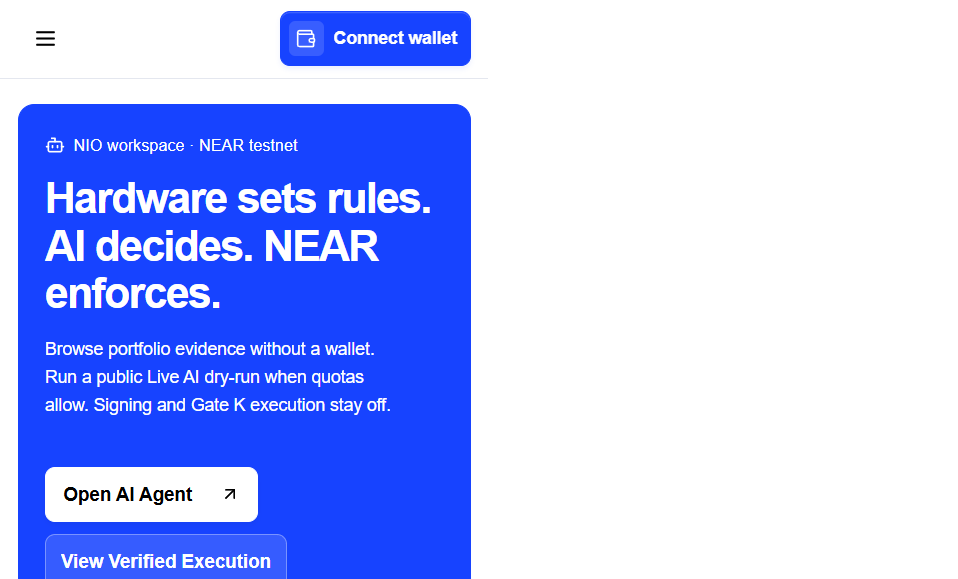
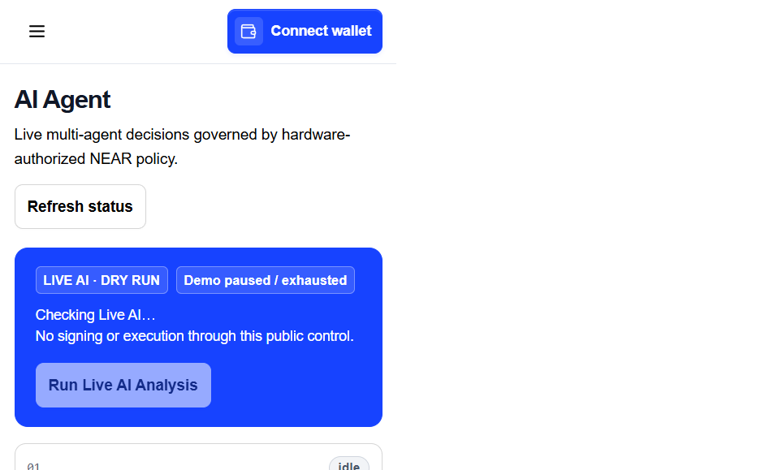

# NIO — NEAR Intent One

**An autonomous DeFi agent governed by a hardware-authorized NEAR smart-contract mandate.** OpenRouter models research, propose and critique; a deterministic Fitter enforces bounded risk; NEAR MPC Chain Signatures enable EVM execution; NEAR Intents handles cross-chain settlement; even rejected AI decisions are independently auditable on NEAR.

Hardware sets the rules. The policy contract—not the agent—owns the multichain signing path. AI can refuse to trade, and that refusal is still a NEAR receipt.

---

**Live product:** https://near-intent-one.vercel.app

**Public mainnet agent:**  
https://near-intent-one.vercel.app/inspect/nishanthb.near

**Proof & Verify:**  
https://near-intent-one.vercel.app/verify

**Mainnet contract:**  
https://nearblocks.io/address/policy.nishanthb.near

**Autonomous NO_TRADE receipt:**  
https://nearblocks.io/txns/CXR4ey3x2x3scEhGeW8sRLnRAVsPrsYiRYFPcTAAAz1s

**Full proof index:** [`docs/PROOF_INDEX.md`](docs/PROOF_INDEX.md)

**Judge quickstart:** [`docs/JUDGE_QUICKSTART.md`](docs/JUDGE_QUICKSTART.md)

---

## Hackathon track

Primary: **Unstoppable DeFi** (`defi`) — Chain Signatures + NEAR Intents trading agent.  
Also fits: **AI Security & Defense** (`security`), **Agent Economy** (`agents`).

**Cross-project disclosure (Q-015):** The same author also submits **Floorline** (Monad track / separate repository). NIO and Floorline are independent products and codebases.

---

## What it does

1. Owner (Ledger) writes a **bounded mandate** on `policy.nishanthb.near` — chains, tokens, destinations, trade/daily/pending caps, slippage, expiry.
2. Agent proposes trades under that mandate; the **contract** requests MPC signatures on a contract-owned derivation path.
3. OpenRouter **Researcher → Strategist → Critic** runs with a **deterministic Fitter** that can reject unsafe or low-edge plans.
4. Settlements use **NEAR Intents / 1Click** across Ethereum, Arbitrum, Base, and NEAR — with independent reconcile.
5. Decision audit WASM records **every finalized decision on-chain**, including **NO_TRADE**.
6. A separate **Agent Market** commerce path can hire research agents under its own escrow budget.

Judges browse the public UI **without connecting a wallet**.

---

## Demo UI





---

## Autonomous pipeline

```text
Owner Ledger
    → NEAR Policy Contract (mandate + pause/revoke + pending exposure)
        → OpenRouter Researcher / Strategist
            → Deterministic Fitter
                → Independent Critic
                    → Decision Journal + On-chain Audit Receipt
                        → NEAR MPC Chain Signatures
                            → EVM / NEAR Intents settlement
                                → Independent Settlement Reconciler
```

**Commerce branch (separate budget):**

```text
Research need → market.near.ai discovery → Commerce Fitter
  → Hire / escrow → External deliverable verification
```

- Agent does **not** receive owner Ledger FullAccess.
- Owner establishes permissions once; on-chain policy enforces scope.
- AI can refuse; refusals are real NEAR receipts.
- Marketplace payments use a **separate** commerce source — not trading capital.

---

## Four-chain policy scope

| Chain | Role |
| --- | --- |
| NEAR | Policy, MPC request, Intents, NEP-141 USDC |
| Ethereum | Native USDC in/out (Intents) |
| Arbitrum | USDC canary path |
| Base | USDC canary / mission path |

Venue allowlist includes `near_intents_1click`. Destinations and assets are exact on-chain allowlists.

---

## Active bounded mandate

**Read live:** `GET https://nio-api-hack26.duckdns.org/mainnet/mandate`

| | At first autonomy activation (epoch **3**) | Current judge renew (epoch **4**) |
| --- | --- | --- |
| Max trade | $1 | **$5** |
| Daily turnover | $5 | **$25** |
| Pending exposure | $2 | **$10** |
| Max slippage | 100 bps | **200 bps** |
| Expiry | ~24h demo window | ~**10 days** (≈ 2026-11-24 UTC) |
| Autonomous / enforce | ON | ON |
| Paused | unpaused after activation | **live / unpaused** |

Renew tx: [GuBY2n5c…](https://nearblocks.io/txns/GuBY2n5cH4oBnhQ4UNJXnqhHs4GKYzvsRoyi9jzdqpCt)  
Original activate: [6zQs6C…](https://nearblocks.io/txns/6zQs6C56tdPYz5BYY9Ca2T4XusU5oavt1gDw3tdDaW93)

---

## On-chain autonomous AI decision

| Field | Value |
| --- | --- |
| Tx | [CXR4ey3x2x3scEhGeW8sRLnRAVsPrsYiRYFPcTAAAz1s](https://nearblocks.io/txns/CXR4ey3x2x3scEhGeW8sRLnRAVsPrsYiRYFPcTAAAz1s) |
| Action | **NO_TRADE** |
| Fitter | REJECTED |
| Reason | NO_OPPORTUNITY |
| Status | ONCHAIN_VERIFIED |

This is the currently proven autonomous outcome under an active mandate. **Not** a settled autonomous swap.

---

## Owner-supervised mainnet Intents settlements

Three funded, reconciled canaries. Label: **OWNER-SUPERVISED MAINNET INTENTS SETTLEMENTS**.

| Mission | Route | EVM transaction | NEAR reconciliation |
| --- | --- | --- | --- |
| **J8B** | Arbitrum USDC → Base USDC | [Arbiscan](https://arbiscan.io/tx/0x4e9583a86d9cc62dd508e72d5e6d965711ef7eeecce5422c42fa7fa37c0d6c48) | [EWLebo…](https://nearblocks.io/txns/EWLeboFnxdTeJK2VatMECPQCZXY9Q5vVyLBFNSboQdNq) |
| **M1** | Ethereum USDC → NEAR USDC (1 USDC) | [Etherscan](https://etherscan.io/tx/0x9bc11fc2869cce36fa1ea1e7cb2ed0cf99917241719a841215ebb5466d7567aa) | [7mCCRb…](https://nearblocks.io/txns/7mCCRb7YtdZewy6G4zksfMaycc3bo3MTWtDN7KHdSRZ3) |
| **M2** | Base USDC → NEAR USDC | [Basescan](https://basescan.org/tx/0xdfbaf42bae71c74efce65f2be1f6553a2c424003e5386be82b70af828d6140e2) | [E3g711…](https://nearblocks.io/txns/E3g711GASJVM492hzeudRrfWjJrig4B9bh29nDFBqhK5) |

---

## Agent Market purchase

- Job: https://market.near.ai/hiring/jobs/e0933c32-5494-45bc-8e7c-9b69a32e548c  
- Provider: `llmrt-onchain-research`  
- **0.15 USDC escrowed** (marketplace balance, not a NEAR L1 payment tx)  
- Status at submission: **IN_PROGRESS — delivery pending**  
- Evidence: [`docs/evidence/COMMERCE_FIRST_PURCHASE_PAID.json`](docs/evidence/COMMERCE_FIRST_PURCHASE_PAID.json)

---

## J18 testnet MPC → Sepolia

**TESTNET · real MPC signature · deterministic ERC20 transfer · NOT Intents · SETTLED**

Sepolia: [0xc9826ca6…](https://sepolia.etherscan.io/tx/0xc9826ca6b7dc80f308fad18ff9ee136b9836907eb7df0ccdeb0f1ddf780c8b53)  
Details: [`docs/PROOF_INDEX.md`](docs/PROOF_INDEX.md) §G

---

## Reproducibility & quick start

```bash
git clone https://github.com/n1shanthb/near-intent-one.git
cd near-intent-one
pnpm install          # Node ≥ 20, pnpm 10.15.0
pnpm run judge:verify # safe: build + unit tests + live read checks
```

Local UI:

```bash
pnpm --filter web run dev
# open http://localhost:5173/inspect/nishanthb.near
```

Full steps: [`docs/JUDGE_QUICKSTART.md`](docs/JUDGE_QUICKSTART.md)

**Judges never need keys.** Owner Ledger ops, funded canaries, and marketplace hire are documented as non-reproducible without credentials.

---

## Testing & verification

| Command | What |
| --- | --- |
| `pnpm run judge:verify` | Read-only end-to-end judge check |
| `pnpm --filter web run build` | Frontend TypeScript + Vite |
| `cd contracts/policy && cargo test` | Policy contract (56 tests) |
| `pnpm run test:autonomous` | Shadow agent / journal / simulate |
| `pnpm run test:mandate` | Mandate schema / allowlists |
| `pnpm run test:commerce` | Commerce fitter + discovery (no pay) |
| `pnpm run test:j16` | Settlement integrity (simulator ≠ settled) |

---

## Security & limitations

- **Pending exposure + mandate epoch** bind intents; `revoke()` blocks new signatures; already-exported EVM signatures may still settle (documented limitation).
- Agent keys are scoped FunctionCall — not owner FullAccess.
- Fitter is deterministic; LLMs are advisory under policy.
- **No claim** of continuous 24/7 keeper uptime.
- **No claim** of autonomous mainnet settled swap — proven autonomous outcome is **NO_TRADE**.
- Dry-run / Anvil / simulated paths are labeled and are not mainnet settlements.
- Secrets (Ledger seeds, agent keys, OpenRouter, OCI) are never in git.

---

## Technology stack

| Layer | Tech |
| --- | --- |
| Policy | Rust NEAR contract (`contracts/policy`) |
| MPC | NEAR Chain Signatures |
| Settlement | NEAR Intents / 1Click SDK |
| AI | OpenRouter (researcher / strategist / critic) |
| Frontend | React + Vite (`apps/web`) → Vercel |
| Public API | OCI Node BFF (`/mainnet/*` reads) |
| Commerce | market.near.ai buyer adapter (`packages/commerce`) |

---

## Repository layout

```text
apps/web/              Product UI + Vercel BFF
contracts/policy/      Mandate, MPC gate, pending exposure, audit events
packages/autonomous/   Keeper / decision journal / fitter integration
packages/commerce/     Agent Market buyer path
packages/mainnet/      Mainnet identities + read helpers
packages/services/     API server + mainnet public audit
docs/evidence/         Checkpoint JSON / MD receipts
docs/PROOF_INDEX.md    Full proof catalog
docs/submission/       Hackathon submission pack
scripts/judge-verify.mjs
```

---

## Team / author

**Nishanth B** · `nishanthb.near` · solo (`size: 1`)

Also building **Floorline** (https://github.com/n1shanthb/floorline) (separate submission). Disclose per hackathon Q-015.

---

## Hackathon submission

| Item | Value |
| --- | --- |
| Event | NEAR HACKATHON |
| Deadline | 2026-11-14 23:59 UTC |
| Form | https://nearhackathon.com/#apply |
| Repo | https://github.com/n1shanthb/near-intent-one |
| Demo X post | *human publishes — placeholder until posted* |
| Pack | [`docs/submission/SUBMISSION.md`](docs/submission/SUBMISSION.md) |

License: [MIT](LICENSE)

---

## Evidence

- Full index: [`docs/PROOF_INDEX.md`](docs/PROOF_INDEX.md)
- JSON receipts: [`docs/evidence/`](docs/evidence/)
- Demo script: [`docs/submission/DEMO_SCRIPT.md`](docs/submission/DEMO_SCRIPT.md)
- Rules checklist: [`docs/submission/RULES_CHECKLIST.md`](docs/submission/RULES_CHECKLIST.md)
